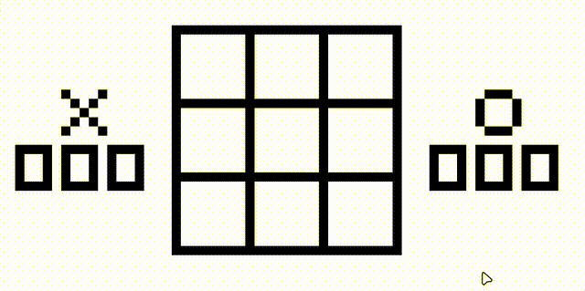
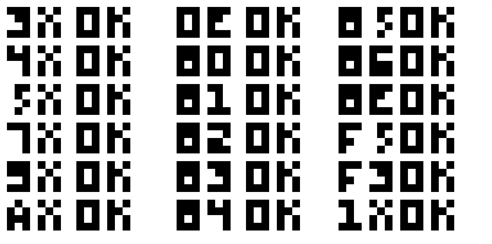

# Chip 8 Emulator
A CHIP-8 emulator written in c++23 using raylib for display and audio.

CHIP-8 is an interpreted programming language, developed by Joseph Weisbecker on his 1802 microprocessor. It was initially used on the COSMAC VIP and Telmac 1800, which were 8-bit microcomputers made in the mid-1970s.
## Examples

breakout:


CHIP-8 Logo:


flightrunner:


tictac:


opcode test rom:


IBM logo:


## How to build
Requires C++23 compiler and [raylib](https://www.raylib.com/)
```sh
g++ -std=c++23 src/*.cpp -lraylib -o emu8pp
```

## How to use

```sh
./emu8pp <BINARY_CHIP8_ROM_FILE>
```

## Controls
The original CHIP-8 hex keypad is mapped to:

```
Keypad       Keyboard  
+-+-+-+-+    +-+-+-+-+  
|1|2|3|C|    |1|2|3|4|  
+-+-+-+-+    +-+-+-+-+  
|4|5|6|D|    |Q|W|E|R|  
+-+-+-+-+ => +-+-+-+-+  
|7|8|9|E|    |A|S|D|F|  
+-+-+-+-+    +-+-+-+-+  
|A|0|B|F|    |Z|X|C|V|  
+-+-+-+-+    +-+-+-+-+
```

## Limitations
- Implements CHIP-8 instructions only, SCHIP and XOCHIP are not supported.

## References
- [Cowgod's CHIP-8 Technical Reference](http://devernay.free.fr/hacks/chip8/C8TECH10.HTM)
